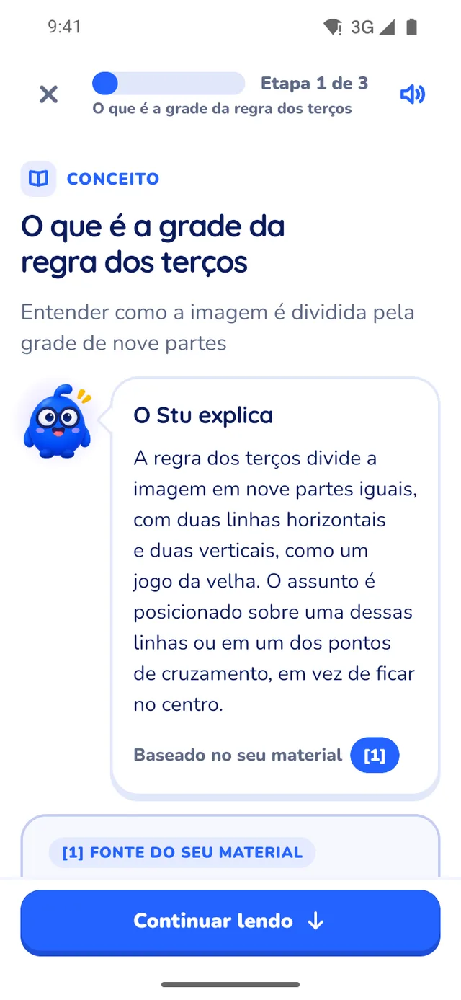
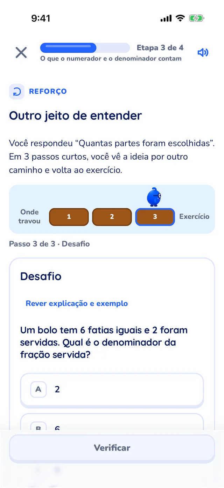
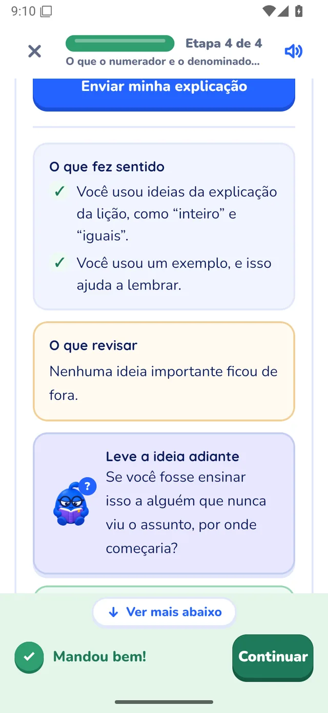
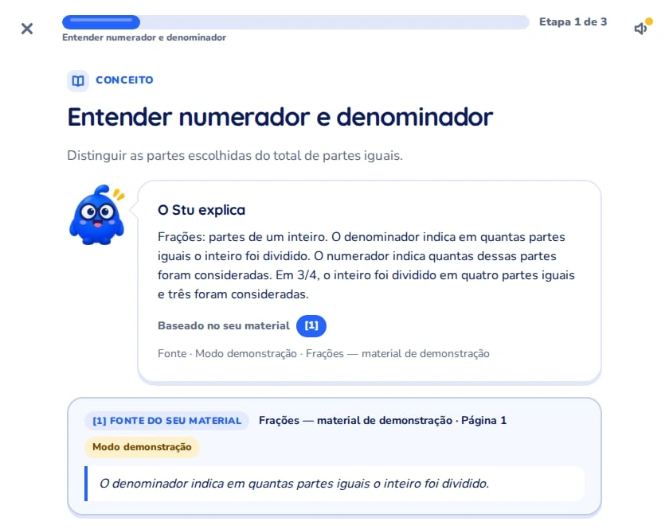
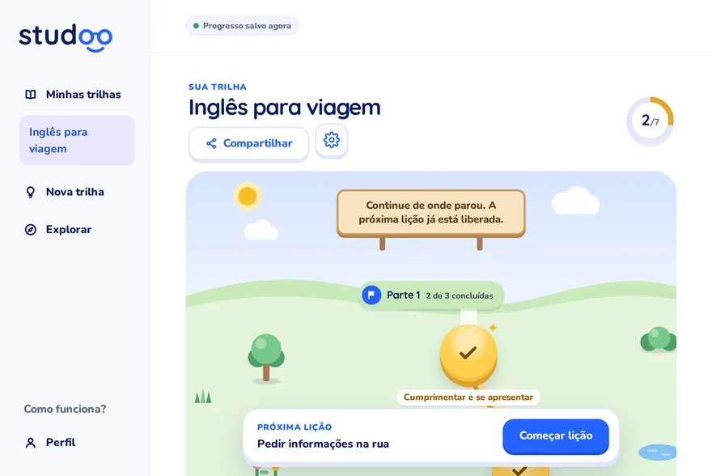
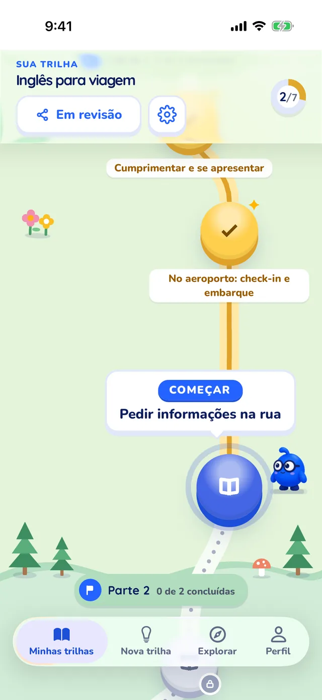
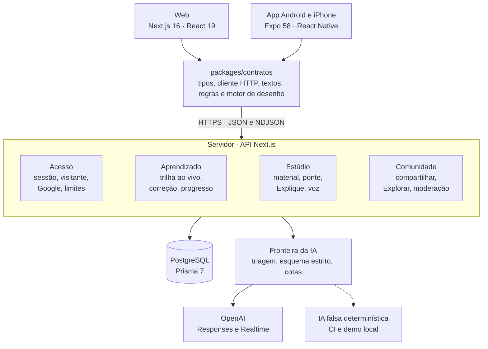

<div align="center">


# Studoo

### Seu caderno vira lição.

O Studoo transforma um assunto, uma foto do caderno ou um PDF em uma trilha de lições curtas.<br>
Quando você erra, ele explica por outro caminho. No fim, você explica com as suas palavras.

**[Experimentar sem conta](https://app.hellostudoo.com.br)** · [Conhecer o Studoo](https://hellostudoo.com.br) · [Instalar o app](https://hellostudoo.com.br/baixar) · [Rodar localmente](#rodar-localmente)

<!-- VÍDEO: quando o vídeo estiver publicado, troque URL_DO_VIDEO pelo endereço e apague esta linha e a linha "FIM DO VÍDEO".
**[Assistir ao vídeo](URL_DO_VIDEO)**
FIM DO VÍDEO -->

[](https://github.com/team-ponto-virgula/studoo-hack-brasil/actions/workflows/verificacao.yml)

**Hack Brasil 2026** · trilha **Acesso à educação** · time **Ponto e Vírgula**

</div>

<table>
  <tr>
    <td align="center" width="25%"></td>
    <td align="center" width="25%"></td>
    <td align="center" width="25%"></td>
    <td align="center" width="25%"></td>
  </tr>
  <tr>
    <td align="center" valign="top"><b>1. Peça ou envie</b><br>Um assunto, uma foto do caderno, um PDF, DOCX ou CSV.</td>
    <td align="center" valign="top"><b>2. A lição cita a fonte</b><br>A explicação aponta o trecho do seu material.</td>
    <td align="center" valign="top"><b>3. O erro vira ponte</b><br>Três passos por outro caminho, e você tenta de novo.</td>
    <td align="center" valign="top"><b>4. Você explica ao Stu</b><br>Com as suas palavras, e descobre o que revisar.</td>
  </tr>
</table>

<p align="center"><sub>Telas do app no iPhone (simulador) e no Android (emulador). A lição da tela 2 foi gerada pela IA real a partir de um PDF. As outras usam o modo demonstração.</sub></p>

<p align="center">
  <a href="#o-problema">O problema</a> ·
  <a href="#como-funciona">Como funciona</a> ·
  <a href="#teste-em-dois-minutos">Teste em dois minutos</a> ·
  <a href="#para-quem-avalia">Para quem avalia</a> ·
  <a href="#a-ia-no-studoo">A IA</a> ·
  <a href="#arquitetura">Arquitetura</a> ·
  <a href="#qualidade">Qualidade</a> ·
  <a href="#rodar-localmente">Rodar localmente</a> ·
  <a href="#limites-conhecidos">Limites</a> ·
  <a href="#time">Time</a>
</p>

## O problema

Quem estuda sozinho encontra vídeos, PDFs e cursos de sobra. O que falta vem depois.

- **Falta praticar.** Dá para passar horas assistindo e travar na hora de fazer.
- **Falta quem explique o erro.** O gabarito diz que está errado, mas não diz por quê.
- **Falta partir do que a pessoa já tem.** O caderno, a apostila da escola e o celular.

Dois dados públicos dão a medida:

- No PISA 2022, **73% dos estudantes brasileiros** ficaram abaixo do nível 2 em matemática, que a OCDE considera o padrão mínimo. Entre os países membros da OCDE, foram 31%. [Fonte: Inep](https://agenciagov.ebc.com.br/noticias/202312/divulgados-os-resultados-do-pisa-2022)
- Entre crianças e adolescentes de 9 a 17 anos que usam a internet, o celular é o principal aparelho de acesso (98%) e é o **único** para 32% dos usuários das classes DE. [Fonte: TIC Kids Online Brasil 2024, Cetic.br](https://cetic.br/media/docs/publicacoes/2/20250512154015/tic_kids_online_2024_resumo_executivo.pdf)

Por isso o Studoo funciona inteiro no celular, começa sem cadastro e lê a foto do caderno.

## Como funciona

| Momento | O que acontece |
|---|---|
| **1. Seu material vira lição** | Você escreve um assunto ou envia foto, PDF, DOCX ou CSV. A trilha se monta na tela, lição por lição. Cada lição feita do seu material mostra o trecho literal e onde ele está: página, parágrafo ou linha. |
| **2. O erro vira ponte** | Errou? **Ver outro jeito de entender** monta uma ponte de três passos a partir da sua resposta: outro caminho, um exemplo novo e um desafio. Depois você volta ao exercício. |
| **3. Você explica com suas palavras** | No fim da lição, você explica ao Stu o que entendeu, por texto, por gravação ou conversando por voz. O retorno vem em quatro partes: o que fez sentido, o que revisar, uma pergunta para levar a ideia adiante e o próximo passo. |
| **4. O progresso acompanha você** | O mapa marca o que foi concluído, onde houve ponte e o que vale rever. O progresso fica no servidor, e a mesma conta continua na web, no Android e no iPhone. |

<p align="center">
  
</p>
<p align="center"><sub>Na web, o cartão <b>Fonte do seu material</b> mostra o trecho literal e a página de onde a lição saiu. Conteúdo de exemplo, rotulado como Modo demonstração.</sub></p>

<table>
  <tr>
    <td width="71%"></td>
    <td width="29%"></td>
  </tr>
</table>
<p align="center"><sub>O mapa da trilha no site e no app. O progresso fica no servidor, então a conta continua de onde parou em qualquer aparelho.</sub></p>

### Por que não um chat de IA?

- **Parte do seu material e mostra a fonte.** Um chat responde com o que sabe. O Studoo monta a lição a partir da sua página e aponta o trecho.
- **Faz praticar.** Toda lição tem exercícios. O erro recebe uma pista, não a resposta.
- **Reage ao erro.** A ponte nasce da resposta que você deu, não de uma explicação genérica.
- **Guarda o caminho.** A trilha, o progresso e o que vale rever ficam salvos na conta.

## Teste em dois minutos

A demo pública roda com a IA real da OpenAI e não pede cadastro.

1. Abra **[app.hellostudoo.com.br](https://app.hellostudoo.com.br)** e toque em **Experimentar sem conta**. A conta temporária dura 24 horas e não pede e-mail.
2. Escreva o que quer aprender e toque em **Montar minha trilha**. Ou toque em **Tenho um material** e envie uma foto do caderno, um PDF, um DOCX ou um CSV. Na primeira vez, o Studoo pede a sua permissão para usar a IA.
3. Se o Studoo perguntar **Por onde começamos?**, responda para ajustar o ponto de partida, ou pule.
4. Confira a trilha e toque em **Começar a lição 1**.
5. Erre um exercício de propósito e toque em **Ver outro jeito de entender**. O Stu monta a ponte e leva você de volta ao exercício.
6. No último exercício da lição, abra **Explique com suas palavras** e escreva ou grave o que entendeu.
7. Conclua a lição e veja o progresso no mapa. Com uma conta, o mesmo progresso aparece no app.

A conta de visitante tem uma cota de trilhas geradas. Com uma conta Google ou de e-mail a cota é maior, e a conversa de voz ao vivo com o Stu fica disponível.

Sem tempo? A [página de apresentação](https://hellostudoo.com.br) tem uma lição de exemplo para usar ali mesmo, sem entrar.

## Para quem avalia

| Critério | O que o Studoo mostra | Onde conferir |
|---|---|---|
| **Execução técnica** | Está no ar com IA real em três plataformas: web, Android e iPhone. O ciclo inteiro funciona: pedir ou enviar material, estudar, errar, reforçar, explicar e continuar em outro aparelho. | [Demo](https://app.hellostudoo.com.br) · [Instalar o app](https://hellostudoo.com.br/baixar) · [O que está pronto](#o-que-está-pronto) |
| **Implementação técnica** | Um contrato único para web e app, correção no servidor, IA atrás de uma fronteira com saída estruturada e triagem de segurança, e 1.399 testes automatizados no CI. | [A IA no Studoo](#a-ia-no-studoo) · [Arquitetura](#arquitetura) · [Qualidade](#qualidade) |
| **Impacto** | Começa pelo que o estudante já tem, o caderno e o celular. Funciona sem cadastro, em português, com leitura de foto e voz. Ensina a fazer em vez de entregar a resposta. | [O problema](#o-problema) · [Privacidade e segurança](#privacidade-e-segurança) · [Limites conhecidos](#limites-conhecidos) |
| **Comunicação** | Página de apresentação interativa, filme de dois minutos gerado por código e uma especificação por recurso. | [Página](https://hellostudoo.com.br) · [Como o filme é feito](video/LEIA-ME.md) · [Especificações](docs/specs) |

## O que está pronto

| Área | O que você encontra |
|---|---|
| **Criar a trilha** | Por assunto, por material (foto, PDF, DOCX ou CSV) ou pelo link de outra pessoa. Um diagnóstico opcional ajusta o ponto de partida. A trilha se monta na tela e pode ser cancelada sem salvar nada. |
| **Estudar** | Conceito, exemplo e exercícios em seis formatos: lacuna, múltipla escolha, ordenar, associar, verdadeiro ou falso com o porquê e resposta aberta. |
| **Recursos da lição** | Desenhados e tocados pelo próprio app: fórmulas, gráficos de função, plano cartesiano e reta numérica; acordes de violão com som; linha do tempo; barra de fração; frases para ouvir e repetir, com conferência da pronúncia; cronômetro de prática. |
| **Reforçar** | Ponte de três passos a partir do erro, com volta ao exercício. Na matemática, o **Resolva comigo** só revela o passo seguinte depois da sua vez. |
| **Explicar** | Por texto, por gravação de até 60 segundos, que vira texto para você conferir, ou em conversa de voz ao vivo com o Stu. |
| **Continuar** | Progresso no servidor, igual na web, no Android e no iPhone. O mapa sugere o que vale rever, e a conta mostra os dias de estudo. |
| **Compartilhar** | Um link entrega uma cópia pronta da trilha, sem custo de IA e sem nada do estudo de quem compartilhou. Há perfil, Explorar por tema, seguir, denunciar e bloquear. |
| **Entrar** | Visitante por 24 horas, Google, e-mail com código e recuperação de senha. |

## A IA no Studoo

A IA escreve as trilhas, lê as fotos, corrige respostas abertas, monta a ponte e comenta a explicação. Ela fica atrás de uma fronteira única no servidor, e as regras abaixo valem para todo pedido.

- **Saída estruturada e validada.** As chamadas vão direto à Responses API da OpenAI (GPT-6 Luna), com Structured Outputs em JSON Schema estrito. Toda lição passa pelo mesmo normalizador e pelas mesmas validações antes de ser salva. [`openai.ts`](src/servidor/ia/openai.ts) · [`comum.ts`](src/servidor/ia/comum.ts)
- **Triagem antes e depois.** O pedido é conferido antes de gerar, e o conteúdo gerado é conferido antes de aparecer ou ser salvo. Sem um veredito válido, nada segue. [`seguranca-trilhas.ts`](src/servidor/ia/seguranca-trilhas.ts)
- **Citação conferida.** O servidor localiza cada citação no texto lido e guarda o trecho literal da página. Citação que não existe é recusada. [`licoes-do-material.ts`](src/servidor/estudio/licoes-do-material.ts)
- **Consentimento no servidor.** Nenhuma rota envia dado da pessoa à OpenAI sem o aceite vigente. Onde há alternativa local, como a correção, o reforço e o retorno da explicação, o estudo segue sem a IA. [`consentimento.ts`](src/servidor/privacidade/consentimento.ts)
- **Só o necessário vai ao modelo.** O pedido leva o objetivo, o material e a lição, sem dados da conta. As chamadas usam `store: false`, e os registros do servidor não guardam o objetivo nem o conteúdo. [`gerador.ts`](src/servidor/ia/gerador.ts)
- **Texto do estudante é dado, nunca instrução.** Materiais, respostas e falas são tratados como dados não confiáveis. O modelo não recebe ferramentas de navegação nem de execução. [`correcao.ts`](src/servidor/aprendizado/correcao.ts)
- **Custo sob controle.** Há cota de gerações por pessoa e por visitante, teto de tokens por lição, prazo em cada chamada e novas tentativas limitadas. [`limite.ts`](src/servidor/ia/limite.ts)
- **Voz sem chave no navegador.** O servidor abre a chamada WebRTC com a Realtime API e a encerra sozinho aos 3 min 15 s. [`realtime.ts`](src/servidor/ia/realtime.ts) · [spec](docs/specs/08-voz-ao-vivo.md)

### IA real e modo demonstração

| | Demo pública | Ambiente local e CI |
|---|---|---|
| **Provedor** | `IA=openai` | `IA=falsa` |
| **Conteúdo** | Gerado na hora, para qualquer assunto ou material | Trilhas prontas e geração determinística, sempre com o rótulo **Modo demonstração** |
| **Chave** | Fica no servidor | Não precisa |

As duas implementam a mesma interface ([`GeradorTrilha`](src/servidor/ia/gerador.ts)). É a IA falsa que permite testar o produto inteiro no CI, sem chave e sem custo. Conteúdo simulado nunca aparece sem o rótulo.

## Arquitetura



| Pasta | O que tem |
|---|---|
| [`src/`](src) | Site e API em Next.js 16, React 19 e TypeScript. |
| [`apps/mobile/`](apps/mobile) | App Expo 58 e React Native para Android e iPhone. |
| [`packages/contratos/`](packages/contratos) | Tipos, cliente HTTP, textos da interface, regras de correção e o motor de desenho, usados pela web e pelo app. |
| [`prisma/`](prisma) | Esquema e migrações do PostgreSQL. |
| [`tests/`](tests) | Mais de 170 arquivos de teste. |
| [`docs/`](docs) | Uma especificação por recurso, guias de build e de operação. |
| [`video/`](video) | O que gera o filme de lançamento: gravação quadro a quadro, composição e trilha sonora. |

### Decisões que sustentam o produto

- **Um contrato para todas as telas.** Web e app importam os mesmos tipos, os mesmos textos e as mesmas regras de [`packages/contratos`](packages/contratos). Tudo o que se faz na web é replicado no app, adaptado ao celular: veja as [regras do projeto](docs/REGRAS-DO-PROJETO.md). Testes de paridade conferem textos, desenhos e regras nas duas plataformas.
- **O servidor decide.** O exercício chega ao aparelho sem gabarito, e a correção acontece no servidor. Propostas e avaliações levam [comprovantes assinados](src/servidor/aprendizado/comprovantes.ts) com HMAC, para o cliente não forjar um acerto.
- **Trilha ao vivo.** A rota `POST /api/aprendizado/propostas/ao-vivo` emite a trilha em eventos NDJSON, lição por lição. Dá para cancelar no meio sem salvar nada. [Spec 03](docs/specs/03-trilha-ao-vivo.md)
- **Matemática desenhada pelo próprio produto.** A IA escreve a fórmula num LaTeX restrito, lido por um [parser próprio](packages/contratos/src/formula.ts), sem `eval` e sem biblioteca. Um [motor puro](packages/contratos/src/motor-visuais.ts) transforma fórmulas e figuras em primitivas, desenhadas em SVG na web, em `react-native-svg` no app e em PNG no servidor.
- **O app instalado não quebra.** O cabeçalho `X-Studoo-Capacidades` diz o que cada versão sabe mostrar. Uma versão antiga recebe a mesma lição num formato que ela entende.
- **Material tratado como entrada hostil.** O servidor confere [tamanho, assinatura e formato](src/servidor/estudio/arquivos.ts). O PDF é lido sem executar scripts, a imagem é normalizada sem metadados e o DOCX tem limite de descompactação. O arquivo bruto não é gravado, e o texto lido expira em 24 horas. [Spec 05](docs/specs/05-estudio-adaptativo.md)

Em produção, o Studoo roda como um serviço Next.js e um PostgreSQL, atrás de um proxy HTTPS.

## Qualidade

- **Verificação em cada PR** e em cada push para `development` e `main`: tipos da web e do app, testes, build de produção, migrações num PostgreSQL de serviço e percursos HTTP completos. [`verificacao.yml`](.github/workflows/verificacao.yml)
- **1.399 testes automatizados, todos passando.** Rodam com o runner nativo do Node, sem chamar serviços externos.
- **Percurso automático do site publicado.** O [`verificar-publicado.mjs`](scripts/verificar-publicado.mjs) entra, cria uma trilha, erra um exercício, monta a ponte, acerta e apaga a trilha. Foi feito para rodar agendado contra a produção.
- **Acessibilidade.** Navegação por teclado nos fluxos principais, foco gerenciado nos diálogos, `prefers-reduced-motion` respeitado na web e no app e contraste conferido em teste.

| Suíte no CI | Testes |
|---|---:|
| Domínio, formatos de lição, paridade, interface e IA simulada | 1.219 |
| Material, reforço, explicação e comunidade, com banco real | 111 |
| Acesso: Google, recuperação de senha e visitante | 30 |
| Percursos HTTP: marco e trilha ao vivo | 39 |
| **Total** | **1.399** |

<sub>Números da [execução de 28/11/2026](https://github.com/team-ponto-virgula/studoo-hack-brasil/actions/runs/46106164386). O estado atual está no selo do alto desta página.</sub>

## Privacidade e segurança

Um produto de estudo recebe material e voz de quem estuda. O Studoo guarda só o que precisa.

- **Consentimento antes de qualquer envio à IA**, com revogação em Perfil, Privacidade e dados.
- **Exclusão da conta dentro do app**, numa transação, com tudo o que é dela.
- **O arquivo enviado não é gravado.** O texto lido do material expira em 24 horas, e a gravação de voz não é guardada.
- **Senhas com `scrypt`**, limite de tentativas de login e CSP com `nonce` em produção.
- **Comunidade com denúncia, bloqueio e moderação.** Fotos e capas passam por análise antes de aparecer para outras pessoas. Não há ranking de pessoas.

[Política de privacidade](https://app.hellostudoo.com.br/privacidade) · [Moderação e suporte](docs/MODERACAO-E-SUPORTE.md)

## Rodar localmente

Requer Node.js 24 ou mais recente. Não precisa de Docker nem de chave de IA.

```sh
npm ci
npm run db:local   # banco local, migrações e conta de demonstração
npm run dev        # em outro terminal
```

Deixe o terminal do `db:local` aberto: ele mantém o PostgreSQL local no ar. Abra [http://localhost:3000](http://localhost:3000) e entre com `STUDOO_EMAIL` e `STUDOO_SENHA`, que o `db:local` grava no `.env`.

- **Modo demonstração.** O ambiente local usa `IA=falsa`. As ideias populares da tela inicial (violão, inglês, culinária, história do Brasil, frações e fotografia) abrem trilhas prontas, e **Experimentar com frações** mostra o percurso com material.
- **IA real.** Crie um `.env.local` com `IA=openai` e `OPENAI_API_KEY`. O `npm run ia:conferir` confere a integração. [Passo a passo](docs/RODAR-LOCALMENTE.md#ia-da-openai)
- **Testes.** `npm run typecheck`, `npm run test:dominio`, `npm run test:formatos` e `npm run test:ia` rodam sem servidor. [Guia do banco, dos testes e do app](docs/RODAR-LOCALMENTE.md)
- **App.** [Build Android](docs/BUILD-ANDROID.md) · [Build iOS e TestFlight](docs/BUILD-IOS-TESTFLIGHT.md)

<details>
<summary>Recursos que ficam desligados por padrão no ambiente local</summary>

<br>

| Variável | O que liga |
|---|---|
| `STUDOO_VISITANTE=1` | **Experimentar sem conta**, com sessão de 24 horas. |
| `STUDOO_COMPARTILHAR=1` | Perfil, foto, compartilhar por link, páginas públicas `/t` e `/p`, Código Studoo e prévia do link. |
| `STUDOO_COMUNIDADE=1` | Explorar, publicar, Em alta, seguir, denunciar e Novidades. Exige `STUDOO_COMPARTILHAR=1`. |
| `STUDOO_COMUNIDADE_DEMO=1` | Conteúdo de exemplo com o selo **Perfil de demonstração** e os comandos `npm run comunidade:demo` e `npm run comunidade:demo:remover`. |
| `STUDOO_VOZ_AO_VIVO=1` | Conversa de voz ao vivo com o Stu. Exige `IA=openai` e `OPENAI_API_KEY`. |

Sem as flags, nada disso aparece e as rotas respondem 404. Os detalhes estão no [`.env.example`](.env.example) e nas specs de [compartilhamento](docs/specs/09-perfis-e-compartilhamento.md) e [comunidade](docs/specs/10-comunidade.md).

</details>

## Limites conhecidos

- **Ainda não fizemos um piloto com estudantes.** O [protocolo](docs/DEMO-HACKATHON.md) está escrito, e a tabela de resultados fica vazia até a coleta. Não publicamos percentual nem depoimento que não medimos.
- **A citação prova a fonte, não a interpretação.** O servidor garante que o trecho existe no material. Não garante que a explicação da IA está certa.
- **A IA real leva tempo e depende da OpenAI.** Montar a trilha e abrir a primeira lição pode levar algumas dezenas de segundos. Se a OpenAI falhar, o Studoo avisa que a geração está indisponível e não troca por conteúdo simulado.
- **O material tem limite.** Arquivos de até 5 MB e PDF de até seis páginas.
- **O app ainda está fora das lojas.** No Android, a instalação é por APK. No iPhone, pelo TestFlight.

Os próximos passos são rodar o piloto e publicar o resultado, qualquer que seja, e levar o app às lojas.

## Time

**Ponto e Vírgula**: [Júlio Akamine](https://github.com/JulioAkaminee) e [Miguel Vaz](https://github.com/miguelvzs).

Somos duas pessoas. Para entregar web, Android e iPhone no prazo do evento, trabalhamos com agentes de IA em papéis fixos: lead, web e API, mobile e QA, design e som. O [regulamento](https://hackbrasil.com/regulamento) permite e recomenda esse uso (item 6.4). O método está no repositório: as mudanças grandes começam numa [especificação](docs/specs), entram por PR, seguem a [regra de paridade](docs/REGRAS-DO-PROJETO.md) entre web e app e passam pela verificação automática. As decisões de produto são nossas.

## Documentação

- [Rodar localmente: banco, testes e app](docs/RODAR-LOCALMENTE.md)
- [Roteiro da demonstração](docs/DEMO-HACKATHON.md)
- [Especificações do produto](docs/specs): [material, reforço e explicação](docs/specs/05-estudio-adaptativo.md) · [qualquer assunto](docs/specs/08-aprender-qualquer-assunto.md) · [voz ao vivo](docs/specs/08-voz-ao-vivo.md) · [paridade entre web e app](docs/specs/07-paridade-web-mobile.md) · [comunidade](docs/specs/10-comunidade.md)
- [Filme de lançamento: como é feito](video/LEIA-ME.md)

## Créditos e origem

Esta entrega retoma a ideia do Studoo com a implementação feita após a abertura de 4 de novembro de 2026, às 21h, no horário de Brasília. O histórico Git foi iniciado para esta entrega. O logo, o ícone e o Stu das boas-vindas são novas exportações raster do kit visual existente do Studoo. Na entrada, a marca aparece uma vez, acima do título, com movimento contínuo na web e no app. A preferência de movimento reduzido exibe a marca estática. Nunito e Quicksand são distribuídas com suas licenças SIL Open Font License. [Nunito](https://github.com/google/fonts/tree/main/ofl/nunito) · [Quicksand](https://github.com/google/fonts/tree/main/ofl/quicksand). Os contornos do Δ e do π das fórmulas de matemática vêm da Noto Sans Bold e Regular (Google, SIL Open Font License 1.1; texto em `public/marca/OFL-NotoSans.txt`); os do Nunito 400, 700 e 800 usados no desenho das fórmulas e dos gráficos vêm das fontes do próprio repositório (o 400, da fonte variável `public/marca/Nunito[wght].ttf`). [Noto Sans](https://github.com/notofonts/noto-fonts)

A música e os efeitos sonoros são compostos e sintetizados por um script do próprio repositório, sem arquivos nem amostras de terceiros. [Como o som é produzido](docs/som/PRODUCAO.md)
