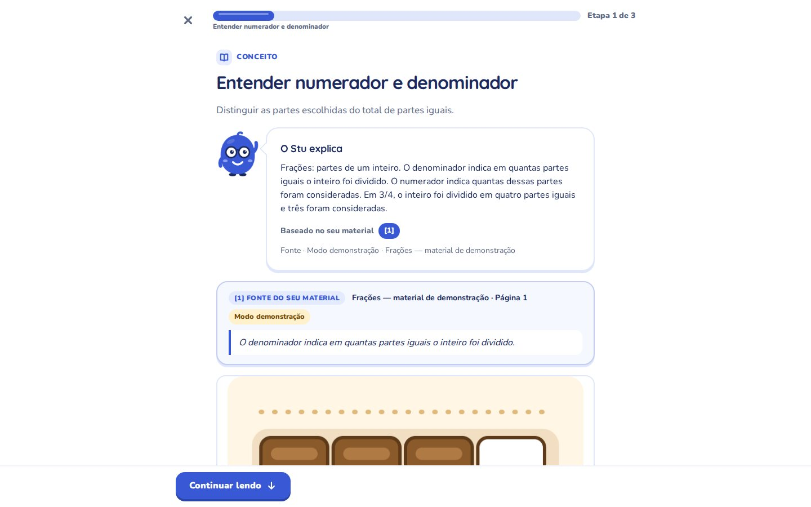
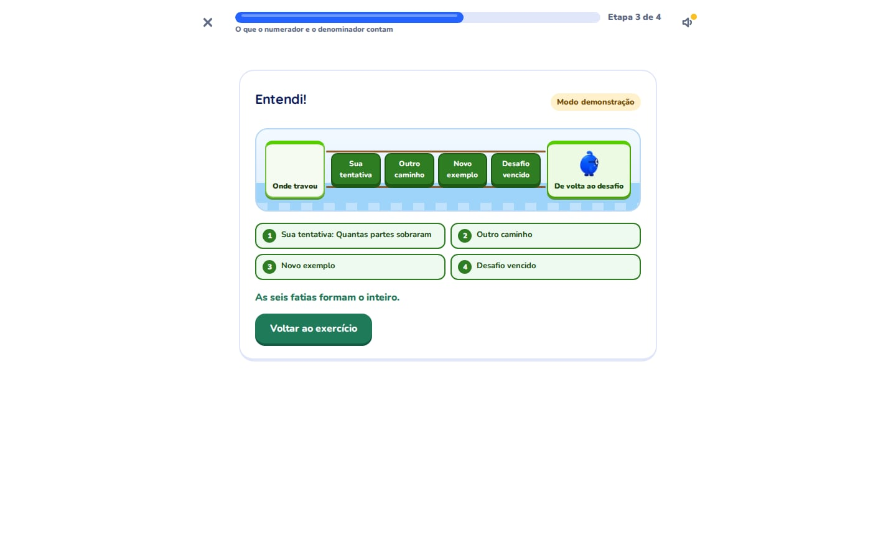
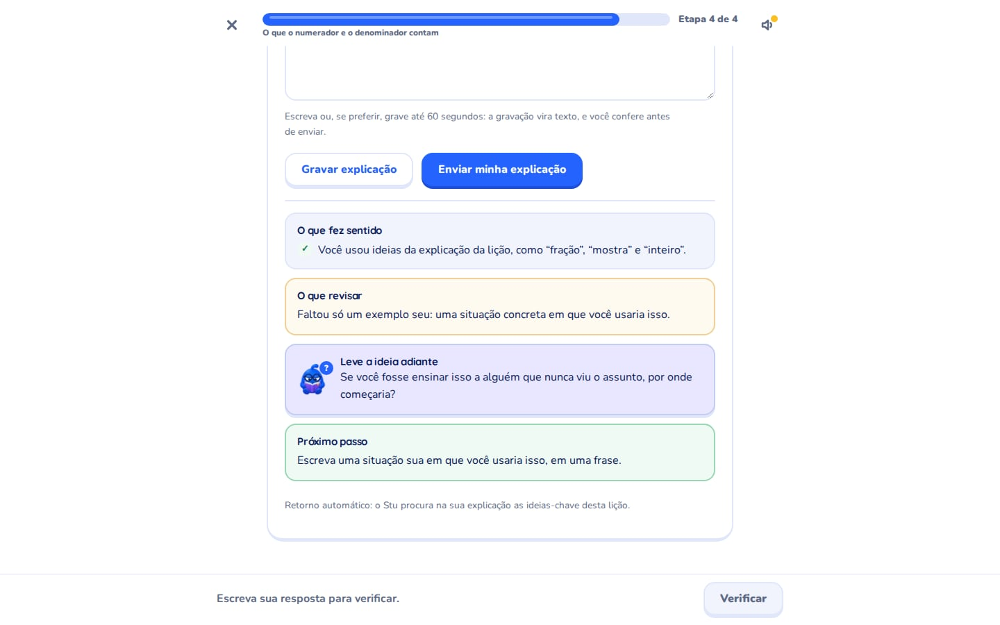
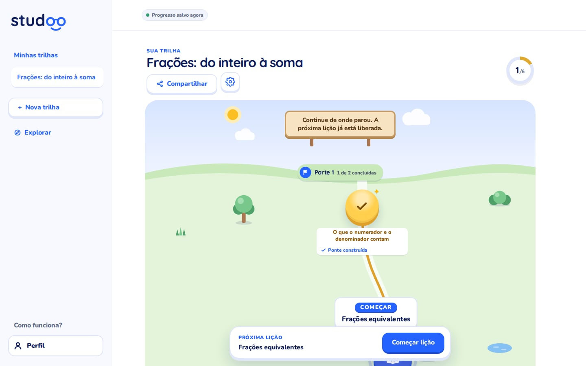
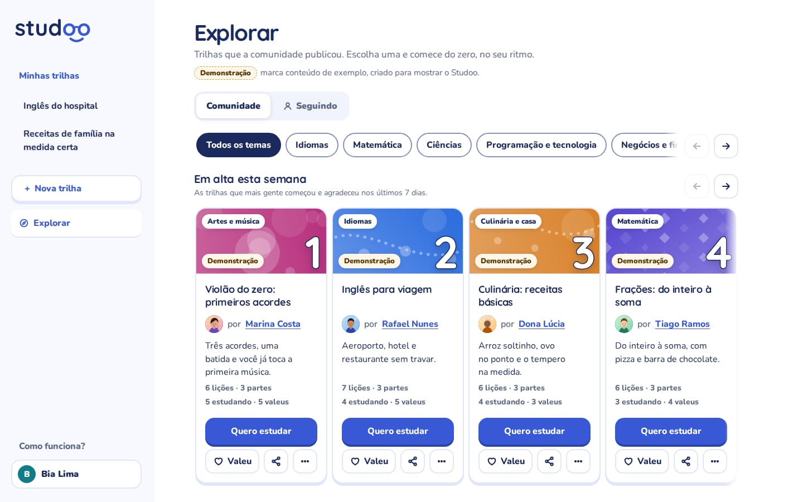

# Studoo · Hack Brasil 2026

O Studoo transforma um objetivo ou material de estudo em lições curtas e interativas, usa o erro para abrir uma ponte de reforço passo a passo e pede que você explique o conceito com suas próprias palavras.

## Os quatro momentos do estudo

### 1. Material próprio com citação verificável
Envie PDF, DOCX, CSV ou imagem (ou use o exemplo pronto **Experimentar com frações**). Cada lição traz o cartão **Fonte do seu material** com o trecho literal e a localização de origem.



### 2. Erro vira ponte de reforço
Ao errar um exercício, **Ver outro jeito de entender** constrói uma ponte em etapas (**Outro caminho** → **Novo exemplo** → **Desafio vencido**) antes de retornar à questão original.



### 3. Explique com suas palavras (opcional)
No fim da lição, você ensina o Stu (por texto ou áudio) e recebe retorno estruturado em quatro cartões: **O que fez sentido**, **O que revisar**, **Leve a ideia adiante** e **Próximo passo**.



### 4. Progresso no mapa e sincronia entre dispositivos
O mapa registra as lições concluídas, destaca **Ponte construída** onde houve reforço e mantém o progresso sincronizado no PostgreSQL entre web e app Android.



## Comunidade: perfil, compartilhar e Explorar

Quem estuda pode mostrar o que criou e encontrar trilhas de outras pessoas, sempre começando do zero e no seu ritmo. Não há ranking de pessoas: o **Em alta** ordena trilhas.

- **Perfil**: foto (recortada no próprio app, sem metadados), resumo, interesses e o alcance das trilhas compartilhadas. Também mostra **Novidades** da semana (quem começou ou agradeceu uma trilha) e quem passou a seguir. O e-mail nunca aparece.
- **Compartilhar**: cada trilha tem três níveis, **Só com o link**, **No meu perfil** e **No Explorar**. Quem recebe adiciona uma cópia pronta, sem IA e sem nada do estudo de quem compartilhou.
- **Explorar**: **Em alta esta semana** (adições e valeus dos últimos 7 dias), temas, **Novas** e a aba **Seguindo**. Cada trilha tem **Quero estudar**, **Valeu** e **Denunciar**.
- **Código Studoo**: um QR próprio com a cara do Stu, com o sorriso, a foto ou a inicial no centro. Dá para baixar como imagem ou projetar em tela cheia. É gerado localmente e lido por dois leitores independentes nos testes.
- **Prévia do link**: o link de uma trilha ou de um perfil abre, nos apps de mensagem, uma imagem com a capa do tema, o título e quem fez.





| Flag | O que liga | Padrão |
|---|---|---|
| `STUDOO_COMPARTILHAR=1` | Perfil, foto, compartilhar por link, páginas públicas `/t` e `/p`, Código Studoo e prévia do link. | desligada |
| `STUDOO_COMUNIDADE=1` | Explorar, publicar, Em alta, Valeu, Denunciar, seguir e Novidades. Exige `STUDOO_COMPARTILHAR=1`. | desligada |
| `STUDOO_COMUNIDADE_DEMO=1` | Mostra o conteúdo de demonstração rotulado (perfis com o selo **Perfil de demonstração**) e libera `npm run comunidade:demo` (cria ou renova as datas) e `npm run comunidade:demo:remover`. | desligada |

Sem as flags, nada disso aparece e as rotas novas respondem 404. Detalhes em [docs/specs/10-comunidade.md](docs/specs/10-comunidade.md).

## Como rodar em três comandos (`IA=falsa`)

Requer Node.js 24+ e Docker (para o PostgreSQL local). Na raiz do repositório:

```sh
npm ci
npm run db:local
npm run dev
```

Abra `http://localhost:3000` e entre com a conta sintética gravada pelo `db:local` no `.env`.

## Pilha e arquitetura

- **`src/`**: aplicação web e API em Next.js 16 + React 19 + TypeScript.
- **`prisma/`**: esquema e migrações do PostgreSQL (`MaterialEstudo`, `ApoioLicao`, trilhas, sessões e limites).
- **`apps/mobile/`**: app nativo Expo / React Native (Android) com os mesmos fluxos e paridade visual. Tudo o que se faz na web deve ser replicado no app mobile, adaptado ao celular: veja as [regras do projeto](docs/REGRAS-DO-PROJETO.md).
- **`packages/contratos/`**: tipos, cliente HTTP, regras de domínio (`trilhaRepetida`) e fonte única de textos (`experiencia.ts`) compartilhados entre web e app.
- **`video/`**: composição do filme de lançamento ([como funciona](video/LEIA-ME.md)).

## Provedores de IA (`IA=falsa|openai|deepseek`)

- `IA=falsa` (padrão local): não exige chaves externas e permite testar todo o fluxo sem custo.
- `IA=openai`: geração ao vivo via Responses API, leitura de imagens/OCR, ponte adaptativa, avaliação da explicação e transcrição de áudio ([como configurar](docs/RODAR-LOCALMENTE.md#ia-da-openai)).
- `IA=deepseek`: geração, imagem e texto via DeepSeek. Com `OPENAI_API_KEY` também configurada (modo misto, o do site), a conversa de voz ao vivo e a transcrição da gravação usam a OpenAI, e o texto que sai delas é avaliado pela DeepSeek; nenhum texto vai para a OpenAI. Sem a chave da OpenAI, a voz e a gravação ficam indisponíveis e a explicação por texto funciona normalmente. A integração está coberta por testes com servidor simulado (`npm run test:ia`) e ainda não foi exercitada com chave real.

## Conteúdo simulado vs. geração real

Com `IA=falsa`, trilhas populares (frações, SQL, violão, inglês para viagem, história do Brasil, culinária e fotografia) e **Experimentar com frações** usam conteúdo autoral rotulado como **Modo demonstração**, e a avaliação de explicações informa explicitamente que é automática/simulada. Nunca exibimos conteúdo simulado sem esse rótulo.

## Qualidade e verificação

- **CI automática** (`.github/workflows/verificacao.yml`): `typecheck` web e mobile, `next build`, migrações/seed e suítes `test:dominio` (inclui `ponte-reaberta`), `test:paridade`, `test:estudio:interface`, `test:movimento`, `test:google-mobile`, `test:formatos`, `test:ia`, `test:email`, `test:estudio`, `test:acesso`, `test:marco` e `test:trilha`.
- **Acessibilidade e segurança**: navegação por teclado nos fluxos principais, foco gerenciado em diálogos, `prefers-reduced-motion` respeitado na web e no app, CSP com `nonce` em produção e proteção de origem/canal.

## Documentação complementar

- [Guia local, banco, testes e app Android](docs/RODAR-LOCALMENTE.md)
- [Roteiro da demonstração (2 minutos)](docs/DEMO-HACKATHON.md)
- [Especificações do produto](docs/specs/05-estudio-adaptativo.md) · [Acesso Google e recuperação](docs/specs/06-acesso-google-recuperacao.md) · [Perfis e compartilhar](docs/specs/09-perfis-e-compartilhamento.md) · [Comunidade](docs/specs/10-comunidade.md)

## Créditos e origem

Esta entrega retoma a ideia do Studoo com a implementação feita após a abertura de 4 de novembro de 2026, às 21h, no horário de Brasília. O histórico Git foi iniciado para esta entrega. O logo, o ícone e o Stu das boas-vindas são novas exportações raster do kit visual existente do Studoo. Na entrada, a marca aparece uma vez, acima do título, com movimento contínuo na web e no app. A preferência de movimento reduzido exibe a marca estática. Nunito e Quicksand são distribuídas com suas licenças SIL Open Font License. [Nunito](https://github.com/google/fonts/tree/main/ofl/nunito) · [Quicksand](https://github.com/google/fonts/tree/main/ofl/quicksand). Os contornos do Δ e do π das fórmulas de matemática vêm da Noto Sans Bold e Regular (Google, SIL Open Font License 1.1; texto em `public/marca/OFL-NotoSans.txt`); os do Nunito 400, 700 e 800 usados no desenho das fórmulas e dos gráficos vêm das fontes do próprio repositório (o 400, da fonte variável `public/marca/Nunito[wght].ttf`). [Noto Sans](https://github.com/notofonts/noto-fonts)
