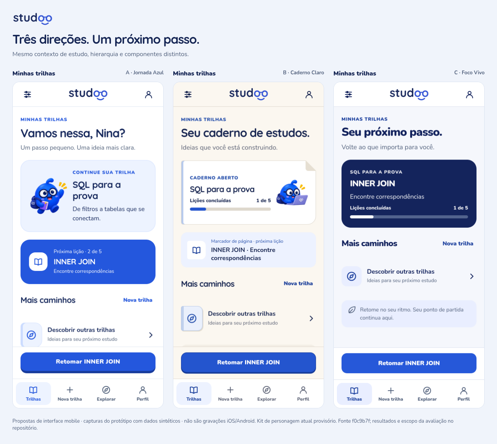

# Três direções para o Studoo mobile

**A · Jornada Azul, B · Caderno Claro e C · Foco Vivo: 35 páginas principais por direção, com nota de desenho 9,0 após sete rodadas.** A candidata examinada é `f0c9b7fb3fb962827fd743096fee935b4873ed29`. A aprovação cobre os protótipos HTML mobile e suas variantes declaradas; implementação instalada e pesquisa com estudantes têm avaliação própria.



| Direção | Proposta | Ver pelo celular |
| --- | --- | --- |
| **A · Jornada Azul — recomendada** | Progressão visível, botões táteis e Stu contextual. A melhor correspondência ao pedido de inspiração no Duolingo. | [PDF, 35 telas](entrega/studoo-direcao-a.pdf) · [Prancha](evidencias/final/prancha-a.png) · [Direção](DIRECAO-A.md) |
| **B · Caderno Claro** | Papel claro, capítulos, margem e marcadores. Afinidade com a referência do Stu caderno. | [PDF, 35 telas](entrega/studoo-direcao-b.pdf) · [Prancha](evidencias/final/prancha-b.png) · [Direção](DIRECAO-B.md) |
| **C · Foco Vivo** | Hero navy, lista linear e leitura concentrada, com menor presença de ilustração. | [PDF, 35 telas](entrega/studoo-direcao-c.pdf) · [Prancha](evidencias/final/prancha-c.png) · [Direção](DIRECAO-C.md) |

Cada PDF tem capa + 35 capturas da dobra inicial em 390×844. Conteúdo rolável e interações estão nos protótipos. O [comparativo de mapas](evidencias/final/comparativo-mapa.png) e as [210 capturas em 390/360](evidencias/final/) complementam a apresentação. O [manifesto](evidencias/final/manifesto-publicacao.json) identifica fonte e hashes dos arquivos.

## Interagir com as propostas

Use a [bancada](prototipo/index.html) por HTTP ou baixe o [pacote dos três HTMLs autossuficientes](entrega/studoo-tres-direcoes.zip). No GitHub, um HTML aparece como código: baixe os arquivos ou use a prévia abaixo. A validação usou HTTP; abertura local depende da política do navegador. O ZIP contém HTML/TXT/licença; PDFs são entregas separadas.

Na raiz desta cópia do repositório:

```sh
python3 -m http.server 3012 --bind 0.0.0.0
```

Abra **`/docs/ux/direcoes-2026-11-24/prototipo/index.html`** na prévia HTTP da porta **3012**. Nesta tarefa, a raiz é `/workspace/work/studoo-ui-directions`. Se não houver uma prévia configurada, adicione a porta em **Edit Environment → HTTP Previews → 3012 → Apply to this chat**.

A bancada escolhe direção, página, estado, formato de exercício e largura. Para experimentar o primeiro SQL do começo: Boas-vindas → apresentação/pular → Experimentar como visitante → objetivo SQL → montar → consentimento demonstrativo → aceitar → escolher `>=` → verificar → concluir sem explicar → mapa → recarregar/retomar. Tudo é local e sintético. Cadastro usa o código demonstrativo `123456`; nenhum email é enviado. “Recomeçar o exemplo local” reinicia apenas o cenário de desenho.

## Critérios, resultados e implementação

- [Resultados e notas por critério](RESULTADOS.md) · [ficha consolidada JSON](AVALIACAO-FINAL.json).
- [Método D1–D10, pesos e gates](COBERTURA-E-REVISAO.md) · [matriz final de 18 famílias/14 lacunas](MATRIZ-COBERTURA-R7.md).
- [Pesquisa adicional](PESQUISA.md) · [referências anteriores](../referencias/) · [brief](BRIEF.md).
- [Plano de implementação dos componentes](PLANO-DE-IMPLEMENTACAO.md).
- [Pareceres independentes R1–R7](revisoes/) · [evidências históricas](evidencias/historico/) · [antes/depois de arte](evidencias/historico/README.md).

Os eventos, progresso, autenticação, IA, email, material, moderação e compartilhamento são exemplos locais. Não há servidor de produto, microfone ou publicação reais. Os assets do personagem são o **kit atual provisório**; os PNGs originais do novo Stu caderno ainda exigem integração e nova conferência de composição.

A correção separada da intro está no **TestFlight interno 0.1.0 (7)**, com [distribuição e verificações registradas](https://github.com/team-ponto-virgula/studoo-hack-brasil/blob/8ae72bb5e45516660a25ae79d1a3518a42bbf18b/docs/beta/BUILD-7-INTRO-BOOT.md). Estas três direções não fazem parte desse IPA. Não houve execução em iPhone/Android nativos nem pesquisa com estudantes nesta avaliação de desenho.
