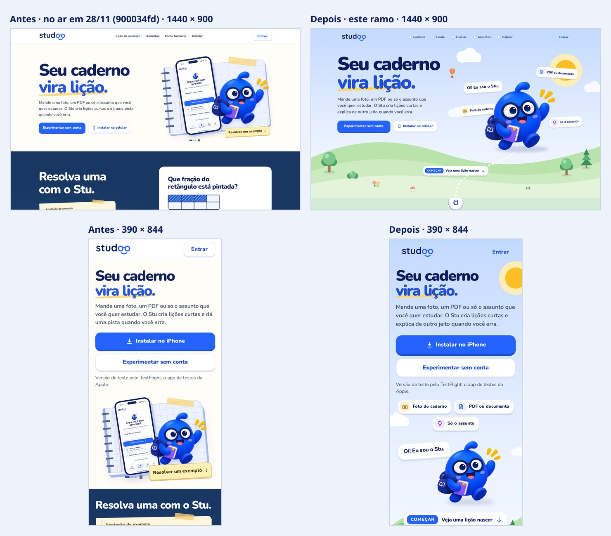
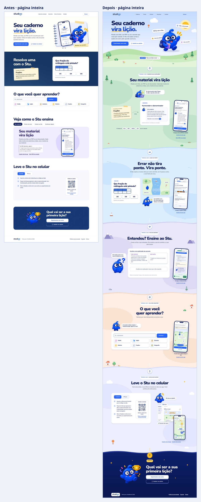
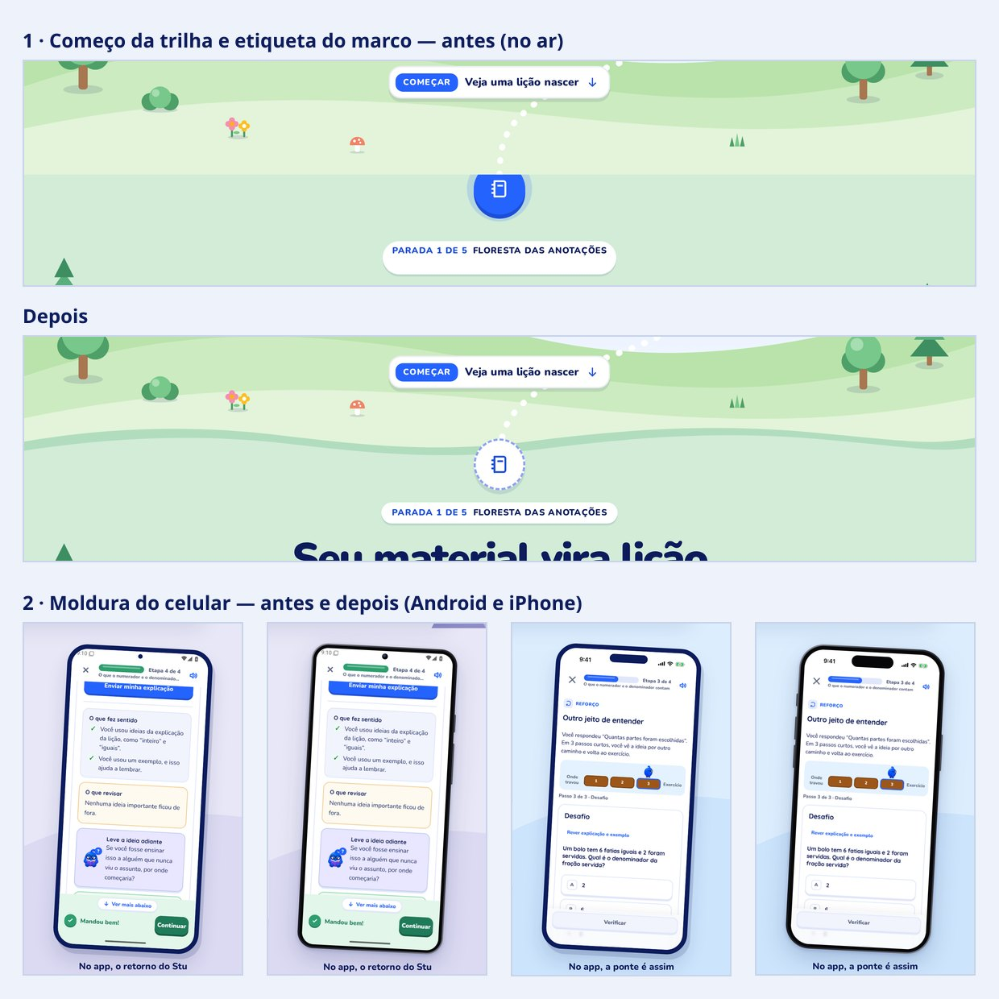

# Página de apresentação em trilha: antes e depois (28/11/2026)

Nova página de apresentação do Studoo (`/` sem conta e `/conheca`), a pedido do dono em 28/11: estudar as páginas de referência e criar "algo sensacional e único, com personalidade". A regra está na [spec 18, seção 0](../../../specs/18-pagina-de-apresentacao.md). Ramo: `design/landing-trilha`.

Este arquivo faz o papel do corpo do PR. O acesso do OpenBot ao GitHub não permite abrir pull requests neste repositório, e o dono pediu para publicar em seguida: o ramo entrou no `feat/hackathon-integracao` por um commit de merge.

**O que muda**

- **A página vira uma trilha do Studoo.** A pessoa desce pelo mesmo mundo do mapa do app: o alto é o campo, e cada parada é uma região do mapa (floresta, lago, montanhas, vila e nuvens), com as cores e os desenhos de `src/ui/mundo-desenhos.ts`. A trilha termina à noite, com o troféu.
- **Uma lição só, do caderno ao troféu.** As três primeiras paradas acompanham a lição de frações:
  1. **Floresta das Anotações.** A anotação vira lição. Tocar no [1] abre a fonte e risca na anotação a frase citada.
  2. **Lago da Ponte.** "Errar não tira ponto. Vira ponte." A pessoa responde a questão. Se erra, vem a pista e três tábuas caem no lago; quando acerta, o Stu atravessa.
  3. **Pico do Entendi.** A pessoa escolhe uma explicação de exemplo e vê o retorno do Stu, com "O que fez sentido" e "O que revisar".
- **Depois, o assunto dela e o app.** A Vila dos Assuntos tem o campo e as seis ideias; Acima das Nuvens tem os passos de instalar, o QR e a mesma trilha no site e no app.
- **O Stu é o anfitrião.** Ele recebe a pessoa no alto e diz uma frase em cada parada.
- **O cabeçalho mostra as paradas como nós de trilha.** O nó da vez fica azul e os que ficaram para trás viram ouro. No celular a trilha vira uma barra de andamento.
- **Cada parada mostra uma tela de verdade do app** ao lado da demonstração, com o link para ampliar. Toda demonstração diz que é exemplo.

**O que não muda**

- Os botões por aparelho (APK, TestFlight, Tela de Início), o cartão do QR, a folha do iPhone e o `/baixar`.
- "Experimentar sem conta" e as seis ideias: a mesma sessão de visitante e o mesmo rascunho que o app lê.
- As capturas nativas, sem recorte. A página usa os momentos 1 a 4, a janela e a trilha pronta.
- A página continua silenciosa e sem números, depoimentos ou logos.

**Saiu**

- O celular do herói com três telas em laço e o botão de pausar, os quatro momentos em abas e a faixa "Resolva uma com o Stu.". O roteiro `scripts/qa/heroi-troca.mjs` saiu junto com o laço.

**Textos novos, para o dono conferir**

- O título do alto não muda. O subtítulo passa a terminar em "explica de outro jeito quando você erra".
- "Errar não tira ponto. Vira ponte.", "Entendeu? Ensine ao Stu." e os nomes dos lugares.
- As falas do Stu, todas em `src/app/conheca/textos.ts`.

**No app:** nada muda. A página só existe na web (spec 07, P34).

**Antes e depois**

Origem das capturas: web, navegador (Chromium sem janela), 28/11. Antes: o site no ar, `hellostudoo.com.br`, em `900034fd`. Depois: build de produção local deste ramo, com a origem pública simulada em https para o QR aparecer. Mesmas larguras: 1440 × 900 e 390 × 844.

**Verificação**

- `npm run typecheck` na raiz: sem erros.
- `npm run test:estudio:interface`: 739 de 739. `tests/conheca-pagina.test.mjs` foi reescrito para a estrutura nova (41 testes).
- `next build`, como o CI, e `next build --webpack`: sem erros. Sem erro de console nas duas.
- axe-core sem violações em 360, 390, 768 e 1280, também com a fonte aberta, a ponte montada, o acerto e o retorno do Stu.
- Larguras conferidas: 320 × 568, 360 × 640, 390 × 844, 768 × 1024, 844 × 390, 1280, 1440 e 1920. Nada passa da largura da janela, e o botão principal fica na primeira dobra em todas.
- Movimento reduzido: tudo à vista desde o começo, sem animação, com os estados finais inteiros.
- Primeira carga com cerca de 550 KB e CLS 0.

**Não conferido**

- Safari e aparelhos de verdade. Tudo foi visto só no Chromium.
- `npm run typecheck` em `apps/mobile` não foi rodado localmente, porque o app não foi tocado. A Verificação do GitHub roda no PR #85, do ramo do site.
- O clique até o fim em "Experimentar sem conta", porque a cópia local não tem banco. O código desse caminho não mudou.

## Ajustes de 28/11, depois de publicar

A pedido do dono, com quatro prints da página no ar. A regra está na spec 18, seção 0.9. Ramo: `design/landing-ajustes`.

- **Moldura de celular realista.** Aro de metal, moldura preta do vidro e botões nas laterais; a ilha no iPhone e um furo de câmera no Android. É desenho de CSS do Studoo, sem imagem nem marca de aparelho.
- **Etiqueta do marco com o texto no centro.** A etiqueta "Parada N de 5" ficava alta, com o texto no alto, e o nó ficava uns 20 px abaixo do lugar. A causa era a mesma: a grade esticava o marco.
- **Começo da trilha sem corte.** O chão do alto cobria a metade de cima do primeiro marco e escondia a onda da primeira parada.

Origem das capturas: web, navegador (Chromium sem janela), 1400 × 820 a 2×, 28/11. Antes: o site no ar, em `e1957cac`. Depois: build de produção local do ramo.

**Verificação**

- `npm run typecheck` na raiz: sem erros.
- `npm run test:estudio:interface`: 740 de 740, com um teste novo do marco e o da moldura reescrito.
- `next build`, como o CI: sem erros, e sem erro de console.
- Em 320, 360, 390, 768, 1024, 1400 e 1920: o centro do nó fica na fronteira em todos os marcos, as seis etiquetas têm o texto no centro, e nada passa da largura da janela.
- axe-core sem violações em 360, 390, 768 e 1280. Movimento reduzido: tudo à vista, sem animação.

**Não conferido:** Safari e aparelhos de verdade.
