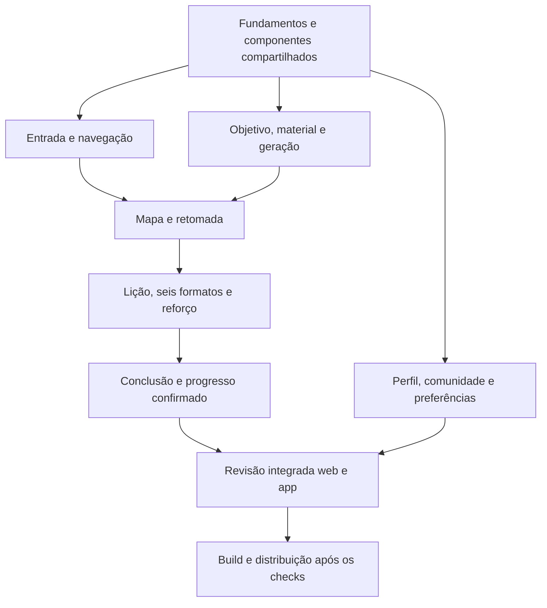

# Implementação da Jornada Azul

25/11/2026 · escolha **A · Jornada Azul** · web móvel e React Native · base `8c057241f6fc4820f36c284218a4f04affa59543`.

O objetivo é transformar a direção escolhida em um sistema de componentes reconhecível do Studoo e organizar os fluxos inteiros. O Stu, a logo e a intro atuais estão aprovados e são preservados. A identidade e a anatomia estão no [sistema](SISTEMA.md); o escopo completo e seus consumidores estão no [inventário](INVENTARIO.md).

**Estado desta ficha:** direção escolhida pelo dono; este plano organiza a execução. Integração e verificações precisam ser consolidadas pelo responsável pela implementação. Este documento não declara que o produto inteiro migrou, não atribui nota e não autoriza publicar um build sem sua conferência. O resultado R7 pertence aos protótipos.

## Dependências e ordem

| Lote | Implementação concreta | Dependência | Evidência para fechar |
| --- | --- | --- | --- |
| **1 · Fundação** | Fonte de tokens, cores/raios/medidas, botões/campos/seleções, cartões, cabeçalhos, progresso, estados e sobreposições. Resolver a concorrência de estilos do piloto Clareza; Jornada Azul passa a ser o padrão. | Base release atual, inventário e contratos. | Catálogo com estados normal/foco/pressão/erro/carga/indisponível e par web/app nas duas larguras. |
| **2 · Orientação** | Entrada, cadastro/recuperação, apresentação, estrutura da tela, cabeçalho e navegação. Hierarquia consistente e destino claro de voltar/sair. | 1. | Percurso conta/visitante conforme flags; campo com teclado; voltar/pular; sem alteração da intro. |
| **3 · Construir o caminho** | Pedido/material, consentimento, geração por eventos, erro/cancelamento, proposta e aceite. Mesmo desenho de nó/parte na prévia e no mapa salvo. | 1–2. | Gerar SQL, ajustar/cancelar/repetir, aceitar uma vez, abrir lição 1; nenhum progresso/prazo inventado. |
| **4 · Aprender e continuar** | Conceito/exemplo, seis formatos, correção, reforço/recursos, explicação opcional, conclusão, Minhas trilhas e retomada. | 1–3. | Errar e recuperar; concluir; confirmar resposta real de salvamento; recarregar e retomar; percorrer os seis formatos. |
| **5 · Contexto pessoal** | Perfil/edição/foto, Explorar/recebida, configuração/capa, compartilhamento, som, privacidade, consentimento, denúncia/bloqueio e ajuda. | 1–2; estados reais dos contratos. | Folhas e confirmações abertas; privacidade de material, conteúdo recebido, falha/repetir, salvar e voltar sem perder contexto. |
| **6 · Consolidar** | Revisão independente, fechamento de achados, documentação de diferenças técnicas, pares finais e registro do commit. | Todos os lotes pertinentes. | Checks exigidos, evidências rastreáveis e ficha preenchida pelo que de fato foi executado. |

Os lotes podem ser trabalhados em paralelo quando suas fronteiras de arquivos e tokens estiverem combinadas. Cada ação deve ter um Conventional Commit próprio. Mudanças de domínio, currículo ou API de outras branches não são incorporadas silenciosamente para fazer uma mudança visual funcionar.

## Regra de migração

1. Fixar o papel do componente e seu contrato acessível antes de mexer na composição.
2. Atualizar a implementação central e os consumidores web/app, preservando callbacks, testIDs, validações, flags e estados de disponibilidade.
3. Retirar a disputa entre overrides antigos e novos. Uma variante temporária preservada por compatibilidade não representa uma segunda direção vigente.
4. Abrir todas as variantes do inventário afetadas pela mudança, inclusive os caminhos de erro e saída.
5. Guardar pares comparáveis em 390×844 e 360×800: mesmo conteúdo, estado, posição de rolagem e flags. Identificar `web`, `app_previa_web`, `ios_nativo` ou `android_nativo`.
6. Corrigir, repetir os casos afetados e só então atualizar o status do componente/fluxo.

Não reescrever a lógica de geração, correção, consentimento, autenticação, publicação ou progresso para facilitar o desenho. Formulários preservam as capacidades existentes; personalização visual usa o objetivo e as preferências reais.

## Régua de revisão de 0 a 10

A implementação mantém os pesos de [C1–C10](../METODO-AVALIACAO.md). A meta da nova UI escolhida é **pelo menos 9,0 em cada critério e fluxo aplicável**, sem achado crítico/alto/médio aberto. A intro mantém sua meta e ficha separadas. Não arredondar 8,99 para 9.

| Critério | Peso | Prova de implementação |
| --- | ---: | --- |
| C1 · Clareza | 12 | Próximo passo e rótulos concretos; texto coerente com conta/visitante e dados reais. |
| C2 · Ação e autonomia | 12 | Começar, voltar, cancelar, pular quando previsto e sair; CTA na dobra e nenhuma ação sem destino. |
| C3 · Hierarquia/adaptação | 12 | Pares 390/360, conteúdo longo, texto 200%, teclado e áreas seguras nas superfícies executadas. |
| C4 · Identidade/acabamento | 8 | Jornada Azul consistente; Stu/logo preservados; alinhamento, tipo, ícones e estados sem ornamento concorrente. |
| C5 · Movimento/som | 10 | Movimento reduzido, pressão/transições, interrupção e som por preferência/gesto; intro preservada. |
| C6 · Acessibilidade | 14 | Contraste/alvos, nomes/papéis/estados, foco/teclado e leitor real onde executado. |
| C7 · Espera/resposta | 10 | Pendência imediata, cancelamento e falha/repetir; nenhum percentual falso. |
| C8 · Feedback/recuperação | 10 | Erro/acerto/parcial além da cor; preservação de entrada; confirmação destrutiva e recuperação. |
| C9 · Continuidade/confiança | 6 | Aceite e conclusão reais; persistência após reload; material/visibilidade/recebida e consentimento corretos. |
| C10 · Paridade/plataforma | 6 | Tarefa e estados equivalentes web/app; diferenças só na spec 07; origem nativa explicitada. |

Âncoras: **0** = falha observada que impede a tarefa; **5** = tarefa parcial/com contorno; **8** = dívida concreta numa variante relevante; **9** = verificações declaradas sustentadas, sem achado crítico/alto/médio; **9,5** = confirmação independente adicional de acabamento/variantes; **10** = nenhum defeito aberto no conjunto examinado. **Sem execução = `null`**, não zero nem aprovação. Uma ausência nativa não recebe nota de screenshot do navegador.

A consolidação usa a menor nota sustentada dos revisores competentes. As evidências precisam distinguir medição objetiva de julgamento visual e de pesquisa com pessoas. A nota não mede satisfação/retenção sem estudo real; uma média alta não esconde um fluxo abaixo da meta.

## Gates antes de encerrar uma tela

- Componentes e estados obrigatórios daquele fluxo estão presentes nas duas implementações.
- As tarefas e saídas foram exercitadas com dados/flags identificados; nenhum CTA ativo sem resposta.
- 390/360, 200%, dados longos, contraste, foco e movimento reduzido têm evidência pertinente.
- Progresso, consentimento, privacidade e confirmação preservam os contratos reais.
- Revisão independente fechou os achados prioritários; correções têm fonte e prova nova.
- Typecheck web/mobile e suites obrigatórias passaram na candidata: `test:paridade`, `test:movimento`, `test:visitante-mobile`, `test:estudio:interface`, `test:formatos`, `test:dominio`.

A conferência em aparelho permanece identificada quando não disponível; não se declara teclado, VoiceOver/TalkBack, permissões, Keychain, áudio ou desempenho nativos aprovados por RN Web. A regra do repositório sobre conferência Android posterior, a pedido do dono, continua valendo. Novas diferenças técnicas entram na spec 07 antes da entrega.

## Registro de entrega

O fechamento deve apontar commit, inventário com status, caminhos executados, ambiente/flags, testes e capturas reais, achados ainda abertos e como abrir a prévia. A PR descreve a aparência e o comportamento finais, o que muda nas duas plataformas e qualquer risco material. Build/TestFlight é uma etapa separada: só uma distribuição efetivamente enviada e confirmada pode ser descrita como disponível.
