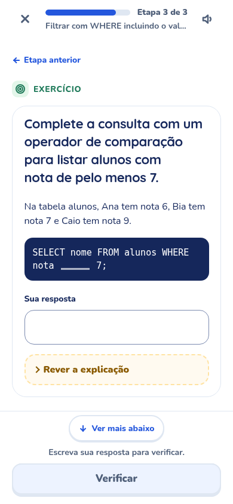
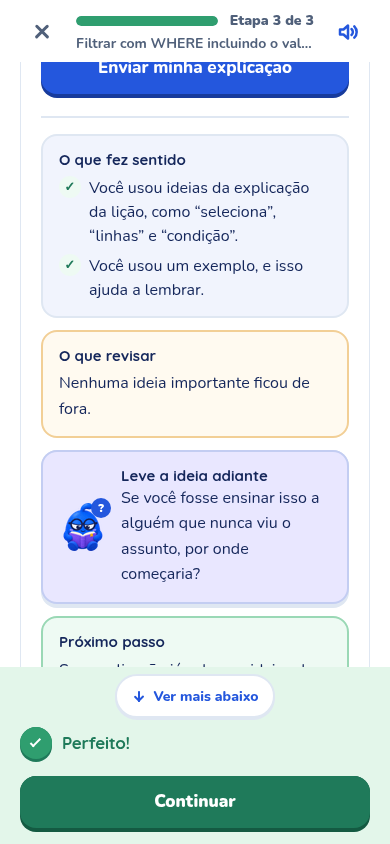

# Jornada Azul · implementação e componentes

**A direção A entrou no código web e React Native.** O sistema partilha fundamentos e organiza os controles, a navegação, a geração da trilha, a aula, a conclusão, o perfil e a comunidade. O Stu, a logo e a intro aprovados foram preservados. Fonte examinada: `b3e97e7cbe7d6b8b711216070453a13ebcad36e3`, sobre a release `8c05724`.

## Ver pelo celular

- [Catálogo dos componentes reais · PDF de 3 páginas](entrega/studoo-jornada-azul-componentes.pdf).
- [Prancha do catálogo](entrega/catalogo-componentes.png).
- [Plano de implementação · seis lotes](PLANO.md) e [inventário de 44 famílias](INVENTARIO.md).
- [Sistema: identidade, anatomia, estados e movimento](SISTEMA.md).
- [Resultados, verificações e limites](RESULTADOS.md) · [registro JSON](RESULTADOS.json).

O catálogo utiliza os componentes de produção em uma bancada de desenvolvimento; seus exemplos não salvam dados. As capturas da aplicação utilizam API e banco locais reais com conteúdo sintético. A amostra abaixo é **RN Web**, não gravação de iPhone/Android:

| Pedido | Exercício | Retorno do Explique |
| --- | --- | --- |
|  |  |  |

Os dois primeiros quadros são da candidata R1 `fa4be429`; o último é R2. [Fontes e equivalência](evidencias/rnweb/fontes.json) identificam o que mudou: só `licao.tsx` no conjunto RN acompanhado. As capturas antigas do CTA estreito permanecem identificadas como antes.

## Reabrir a prévia

A aplicação está servida na **porta 3020**; o catálogo local fica em **`/sistema-ui`**. Na interface do Cloud, adicione **3020** em **Edit Environment → HTTP Previews → Apply to this chat**, se a porta ainda não estiver configurada. A página de catálogo só existe em desenvolvimento; o build de produção responde **404** nela.

Se o processo tiver parado, nesta cópia:

```sh
cd /workspace/work/studoo-jornada-azul
npm run dev -- --hostname 0.0.0.0 --port 3020
```

Use a entrada como visitante para conferir SQL. O banco isolado é `studoo_jornada_azul`, com `IA=falsa` e `EMAIL=falso`; nenhum email ou chamada de IA externa é necessário. Os segredos locais ficam no `.env` ignorado pelo Git. PostgreSQL precisa estar ativo em `127.0.0.1:55432`; o bootstrap do repositório e o [guia local](../../RODAR-LOCALMENTE.md) explicam a configuração em um ambiente novo. Não substitua o banco isolado desta tarefa pelo banco da demo.

## O que a entrega significa

Há implementação nas duas plataformas, typechecks, build web, exportação do bundle iOS e testes de fluxo com persistência real. A revisão independente deu **9 às facetas observadas** de fluxo e composição. Isso não é nota integral das 44 famílias, pesquisa com estudantes ou aprovação de execução nativa.

Permanece **AR8**, baixo: durante o aviso inicial de música, parte de uma ação secundária já usada pode ficar coberta no conteúdo rolado do Explique; Continuar fica livre. Os quadros transitórios estão preservados, e [o plano registra o acompanhamento](PLANO.md#acompanhamento-residual-da-revisão-r2). Uma captura após a dispensa normal do aviso não elimina esse estado.

Esta entrega é código e evidência para revisão. **Não houve nova distribuição TestFlight desta UI.** A intro do build interno 7 é uma entrega anterior e permanece preservada.
