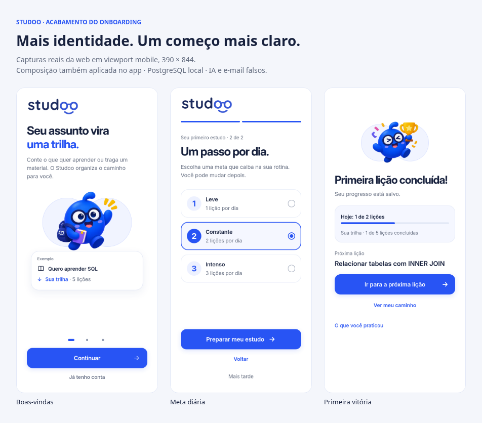

# Acabamento do onboarding · 26/11/2026

O fluxo completo de onboarding e a base de retenção já estão implementados. Esta rodada refina boas-vindas, preparação por objetivo/meta e primeira vitória na web e no app. O restante da UI ainda precisa ser unificado. A entrega continua no [PR #97](https://github.com/team-ponto-virgula/studoo-hack-brasil/pull/97), sem publicação em produção ou TestFlight.

[Antes e depois](comparativo.png) · [Arquivos individuais](galeria.json) · [Resultado web](web.json) · [Resultado do app](app-rnweb.json) · [Verificações e builds](verificacoes.json)

## O que mudou

- **Boas-vindas:** título editorial com destaque em cobalto; Stu, lentes e exemplo formam uma cena integrada. O mascote aprovado foi preservado. As três páginas continuam manuais, com o movimento finito dos óculos da logo.
- **Objetivo e meta:** cabeçalho mais curto, progresso em duas etapas, campo mais confortável e ações agrupadas no fim. Metas numeradas em círculos, estados claros e um único radio por opção.
- **Primeira vitória:** confirmação curta, uma superfície para meta real e avanço da trilha, próxima lição e ação principal. Nome da lição concluída e prática ficam nos detalhes. A pose com troféu é a mesma nos dois clientes.
- **Base compartilhada:** textos, cores e medidas em `@studoo/contratos/onboarding-visual`; cenas correspondentes em cada plataforma. Fluxo, consentimento de IA e persistência permanecem os da entrega funcional.

## Progresso real

| Parte | Estado |
| --- | --- |
| Cadastro → objetivo/material → meta → diagnóstico opcional → trilha → primeira lição | Implementado e exercitado com dados sintéticos. |
| Meta diária, primeira conclusão, próximo estudo e retomada | Funcionam por conta, com progresso confirmado pelo servidor. |
| Boas-vindas, preparação e primeira vitória | Refinados nesta rodada, com capturas em 390×844 e 360×800. |
| Login e criação de conta | Base minimalista preservada; Google antes de Apple quando disponíveis. Botões acompanham o acabamento novo. |
| Geração/proposta, lição e mapa | Funcionam, mas ainda usam partes da linguagem visual anterior. São os próximos blocos de design. |
| Release/TestFlight | Esta versão ainda está no PR, sem distribuição. |
| Retenção medida em usuários | Ainda não há medição de coortes D1/D7 ou resultado de retenção comprovado. |

## Revisão e verificação

UI principal em `34a4c4a`, com ajuste da anatomia do botão web em `01b3a4b`. Os JSONs registram hashes e composição das provas. São 28 capturas finais: sete estados, duas larguras e duas superfícies. O app foi executado como **React Native Web**, com API MOBILE e PostgreSQL locais; não foi executado em iPhone, Android ou emulador nativo.

Os percursos confirmaram criação/login, SQL, erro e acerto, ensino textual ao Stu, conclusão 1/5, meta 1/2, retomada e login com armazenamento limpo. Uma conta criada no canal mobile e interrompida foi retomada voluntariamente na web. IA e e-mail permaneceram falsos; as evidências não contêm código, senha ou token.

Critérios conferidos:

- CTA inteiro, tocável e antes das saídas secundárias em 390×844 e 360×800; nenhum overflow horizontal.
- Seleção única, erro, foco e reflow web a 200%, com rolagem natural.
- Rodapé de objetivo/meta alinhado: y668 em 390×844 e y624 em 360×800.
- Aviso real de música sem cobrir Stu ou CTA. O app reutiliza `avisoNoFluxo`; a web mantém a reserva medida pelo DOM.
- Nome da próxima lição com Inter 600, 18/26 e tracking zero nos dois clientes, sem cortar texto para forçar uma linha.
- Radio normal com contraste de 3,212:1 contra branco; texto secundário com 5,35:1 e cobalto com 5,73:1. Movimento reduzido conserva a interface estática; controles mantêm foco.

Passaram typechecks web/mobile, 703 testes de interface, paridade 5/5, movimento 6/6, visitante 8/8, Google 17/17, formatos 271/271 e domínio 18/18. Também passaram build web de produção em checkout isolado e export Hermes para iOS/Android. Export não é IPA/APK nem execução nativa.

A revisão visual independente identificou ganho em hierarquia, identidade e composição. Não foi atribuída uma nota estética como se fosse resultado de pesquisa com usuários. Testes de aparelho, teclado, VoiceOver/TalkBack e desempenho nativo continuam pendentes.

## Próximos blocos de UI/UX

1. **Geração e proposta da trilha:** levar títulos, superfícies e botões até a primeira lição, preservando geração e aceite reais.
2. **Lição e exercícios:** revisar a hierarquia entre conteúdo, resposta, ajuda e feedback com o mesmo sistema de componentes.
3. **Mapa e retomada:** reduzir a competição entre cabeçalho, compartilhar, configurações e caminho; destacar o próximo estudo. Hoje é a maior ruptura visual ao sair do onboarding novo.

Cada bloco será revisto em 360/390, web/app, estados de erro e retorno. Esta rodada evolui as telas centrais do onboarding; não representa uma repaginação concluída de todo o Studoo.
