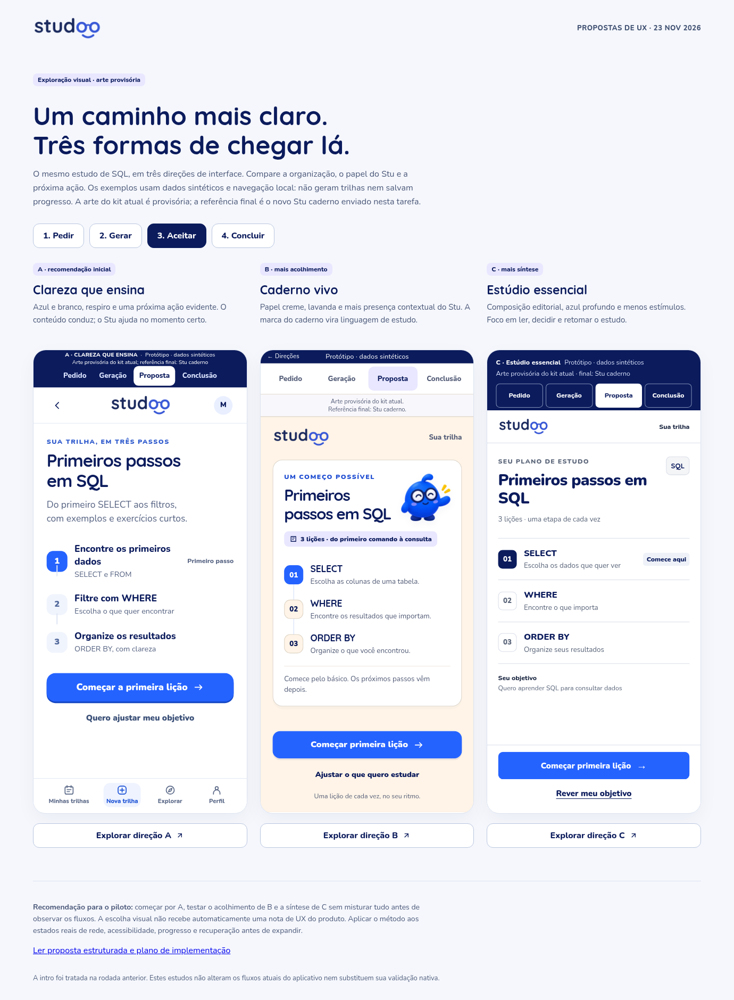

# Três direções para o Studoo

**Recomendação inicial: A — Clareza que ensina.** As três usam o mesmo exemplo de SQL. São protótipos de apresentação com dados sintéticos e arte provisória; não são telas novas já integradas ao app.

- **A — Clareza que ensina:** hierarquia limpa, foco na próxima ação e melhor folga na dobra. [Proposta](capturas/a-proposta-390.png) · [Conclusão](capturas/a-conclusao-390.png) · [Detalhes](direcao-a.md).
- **B — Caderno vivo:** creme/lavanda, grupos em papel e mais acolhimento. [Proposta](capturas/b-proposta-390.png) · [Conclusão](capturas/b-conclusao-390.png) · [Detalhes](direcao-b.md).
- **C — Estúdio essencial:** composição editorial, maior síntese e menos estímulos. [Proposta](capturas/c-proposta-390.png) · [Conclusão](capturas/c-conclusao-390.png) · [Detalhes](direcao-c.md).

[Ver comparação das conclusões](capturas/comparativo-conclusao.png) · [Plano de reorganização e implementação](PROPOSTA-UI-UX.md) · [Revisão independente](REVISAO-DIRECOES.md).

O [Stu caderno dos PNGs do dono](../REFERENCIAS-DO-STU.md) é a referência final. O kit atualmente disponível no repositório mostra outro personagem e está identificado como provisório nos estudos. A integração final dos originais ainda precisa ocorrer.

**Conferência executada:** 24 estados/larguras (quatro estados × três direções × 390/360), sem erro JS ou rolagem horizontal e com CTA principal ≥48 px visível. Mais revisão visual independente de contraste, dobra e leitura. [Resultados do roteiro](capturas/verificacoes.json). Isso não atribui nota de UX ao produto real.

**Explorar no ambiente Cloud:** `node scripts/qa/previa-direcoes.mjs` e abrir `http://localhost:8084` no navegador do ambiente. O servidor já está ativo nesta tarefa enquanto a instância continuar viva. O roteiro `QA_OUT=.studoo-local/propostas-qa node scripts/qa/direcoes.mjs` repete as capturas, usando as dependências de browser do [ensaio da intro](../../../scripts/qa/ABERTURA.md).
